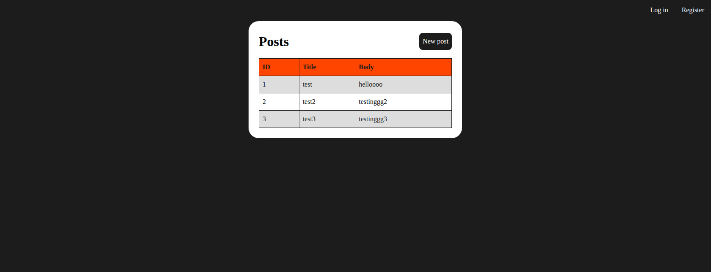
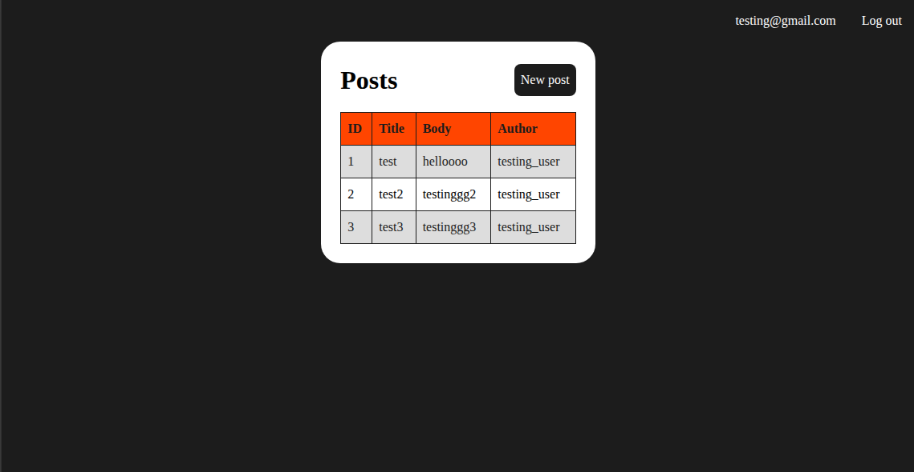

# Project: Members Only

This is a project completed as part of The Odin Project's Ruby on Rails course. The main objective is to implement authentication and authorization in Rails. The following skills/concepts will be demonstrated:

- Usage of Rails' form helpers to create forms such as `#form_with`, labels and parameters
- Usage of the `devise` gem for authorisation and authentication such as its helper methods and generation of views and models.
- Usage of CSS to style Rails views.

## Project Description

In this project, an exclusive clubhouse is built where users who have signed-in can write anonymous posts and see the author of each post. However,users who have not signed in yet cannot see the author of each post.

## Results

Index view for posts viewed by a non-signed-in user :

Index view for posts after the user has signed in:

